I build **applied AI systems**, real-time computer vision and RAG, and test them on real cases before anyone relies on them.

#### selected work

<table>
<tr>
<td width="50%" valign="top">

**[air gesture controller](https://github.com/MateoNeiraCastillo/air-gesture-controller)** 
webcam-only game controller: thumb gestures → key presses, calibrated per user. 
`~70 ms` `99.4%` `153 tests` 
python · mediapipe · opencv · pytest

</td>
<td width="50%" valign="top">

**[sign language translator](https://github.com/MateoNeiraCastillo/SignLanguageTranslator)** 
spanish sign language fingerspelling → text and speech, from a webcam. 
`96.4% leakage-free` `8,060 samples` 
python · mediapipe · scikit-learn

</td>
</tr>
</table>

> [!TIP]
> **Came from an IE Coding Club workshop?** All the code from the sessions lives in [coding-club-workshops](https://github.com/MateoNeiraCastillo/coding-club-workshops).
