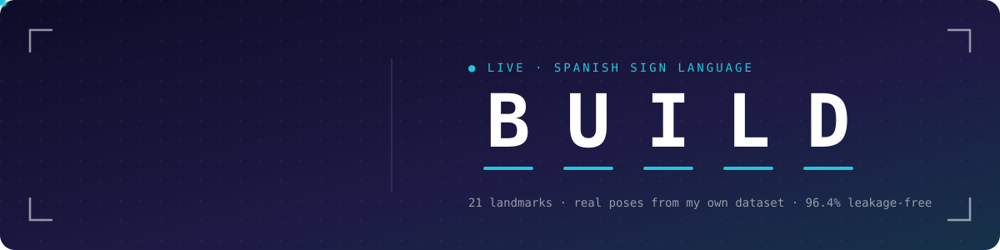

<!-- ───────────── header ───────────── -->


<div align="center">

<a href="https://www.linkedin.com/in/mateo-sebastian-neira-castillo-9514b5351"></a>

</div>

<!-- ───────────── about ───────────── -->
```python
about = {
    "studying":   "cs & ai @ ie university",
    "into":       ["computer vision", "applied ml", "competitive programming"],
    "competed":   "IOI 2024, IOI 2025 — Ecuador",
    "coaching":   "ecuador's national programming team (c++)",
    "teaching":   "workshops @ ie coding club",
    "rule":       "if it says 99%, check for leakage",
}
```

<!-- ───────────── projects ───────────── -->
<h3 align="center">things i've built</h3>

<table>
<tr>
<td width="50%" valign="top">

#### 🖐️ [air gesture controller](https://github.com/MateoNeiraCastillo/air-gesture-controller)
an invisible nes controller. thumb gestures → key presses. plays subway surfers with just a webcam.

`~70 ms` frame-to-key · `99.4%` worst-button accuracy · `153` tests in ci<br/>
<sub>python · mediapipe · opencv · github actions</sub>

</td>
<td width="50%" valign="top">

#### 🤟 [sign language translator](https://github.com/MateoNeiraCastillo/SignLanguageTranslator)
reads spanish sign language from a webcam and says it out loud. first score was 99%. it was leakage.

`96.4%` leakage-free · `8,060` samples recorded · `26` letters<br/>
<sub>python · mediapipe · scikit-learn</sub>

</td>
</tr>
</table>

<p align="center">👋 <b>coding club:</b> came from one of our workshops? all the code lives in <a href="https://github.com/MateoNeiraCastillo/coding-club-workshops"><b>coding-club-workshops</b></a></p>

<!-- ───────────── stack ───────────── -->
<h3 align="center">stack</h3>

<p align="center">
  <br/>
  
</p>

<p align="center"><sub><code>// currently learning</code></sub></p>

<p align="center">
  
</p>


